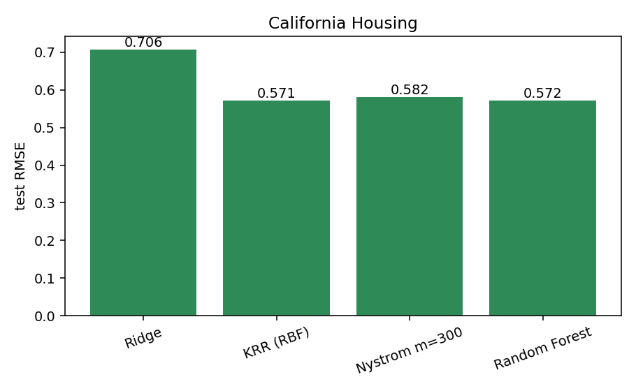
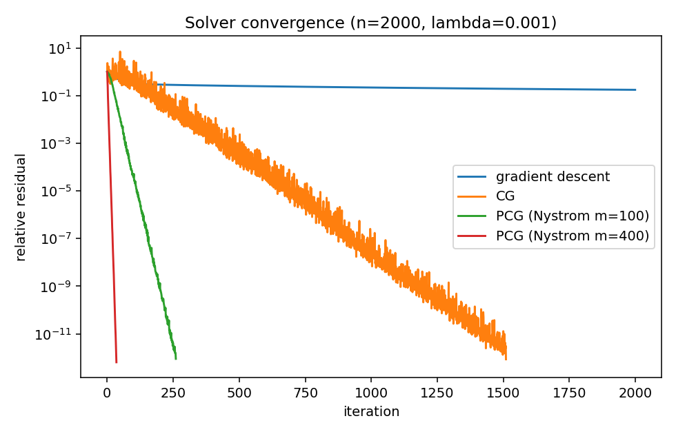
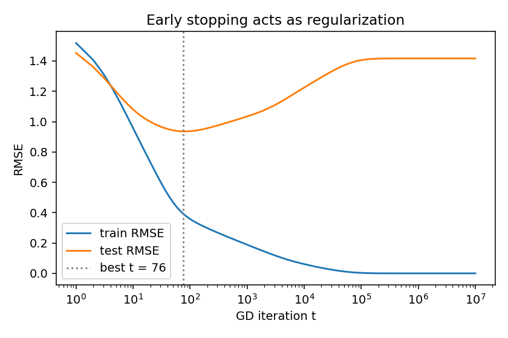
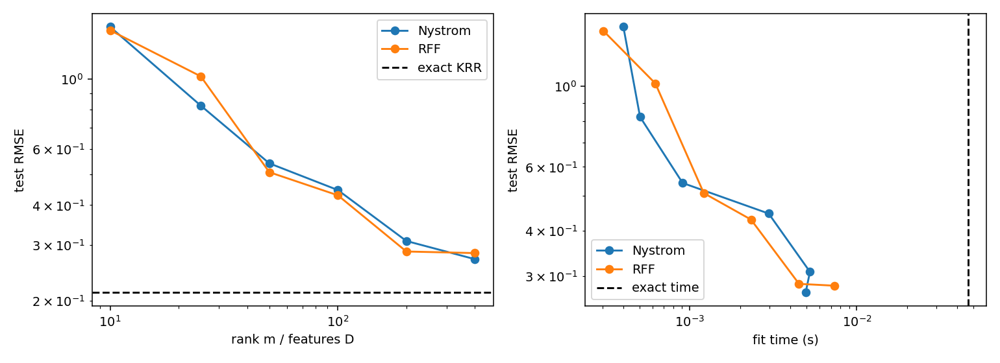
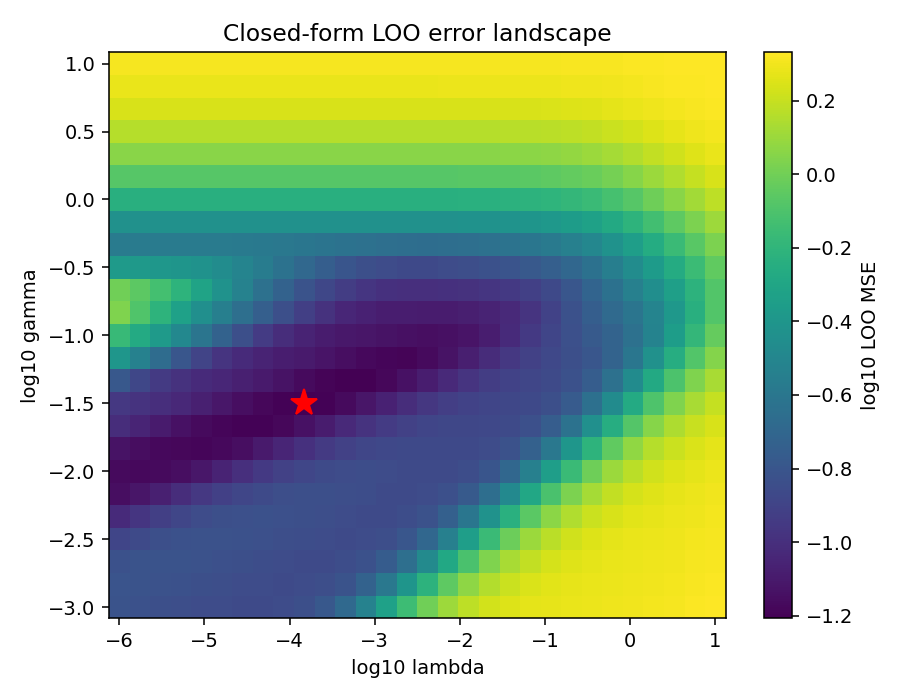

# Kernel Ridge Regression from Scratch

Exact and approximate kernel ridge regression (KRR) implemented in NumPy/SciPy, with a focus on the optimization side: Cholesky and conjugate-gradient solvers, a Nystrom preconditioner, closed-form leave-one-out CV, and low-rank approximations (Nystrom, random Fourier features).

## Run

    pip install -r requirements.txt
    python krr_project.py            # all 10 experiments; figures saved to figures/
    python krr_project.py --quick    # smaller sizes, fast
    python krr_project.py --exp 7 8  # chosen experiments

## Main results

**California Housing (n = 4000, 70/30 split, hyperparameters chosen by closed-form LOO)**

| Model | Test RMSE |
|---|---|
| Ridge (linear) | 0.7065 |
| KRR (RBF) | 0.5707 |
| Nystrom KRR (m = 300) | 0.5818 |
| Random Forest (200 trees) | 0.5715 |

KRR cuts test error by about 19% relative to linear ridge and is on par with a random forest. The implementation matches scikit-learn's `KernelRidge` to about 1e-13.

**Solvers.** On a system with condition number about 9e5, Nystrom-preconditioned CG (m = 400) reaches 1e-12 relative residual in 35 iterations; plain CG needs on the order of 1500 and gradient descent does not converge in 2000.

**Early stopping as regularization.** Gradient descent on the kernel least-squares problem has its best test error at iteration 76; running to convergence raises test RMSE from 0.94 to 1.42.

**Low-rank approximation.** Both Nystrom and random Fourier features improve steadily with rank but remain above exact KRR (0.21) at rank 400 (about 0.27 to 0.28). Results are from a single seed.

**Hyperparameter selection.** Closed-form LOO from a single eigendecomposition is about 10x faster than 5-fold CV and tracks it closely.

## Experiments

| # | Description |
|---|---|
| 1 | 1D toy fit: underfit, good fit, overfit |
| 2 | (lambda, gamma) LOO error heatmap |
| 3 | Linear vs polynomial vs RBF kernels |
| 4 | Closed-form LOO vs k-fold CV |
| 5 | Fit-time scaling with n |
| 6 | Eigenvalue decay and conditioning |
| 7 | GD vs CG vs preconditioned CG; early stopping |
| 8 | Nystrom and random Fourier features vs exact |
| 9 | Real data vs ridge and random forest |
| 10 | Validation against scikit-learn |

## Limitations and next steps

- Comparisons between methods use one random seed; multi-seed runs with error bars are planned.
- Fit-time measurements are noisy at small n and sit below the theoretical n^3 slope because kernel construction and multithreaded LAPACK dominate at these sizes.
